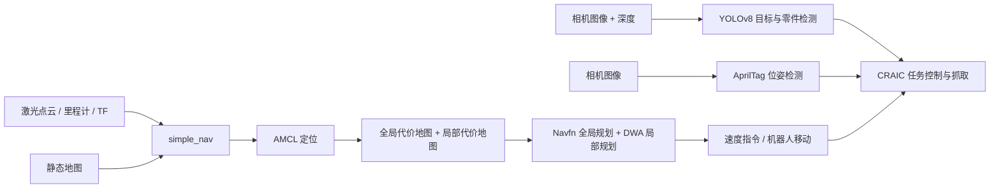

# SLAM 代码与成果展示

本目录是 SLAM 课程资料的实践补充，展示定位导航、视觉识别、AprilTag 定位线索和仿真任务控制如何组合到机器人自主移动流程中。它包含 4 个 ROS1 功能包和 3 段演示视频。

## 系统组成



| 功能包 | 作用 | 主要入口 |
| --- | --- | --- |
| `simple_nav` | 地图服务、AMCL 定位、move_base 导航；Navfn 全局规划和 DWA 局部规划 | `launch/craic_sim_nav.launch`、`launch/scene2_table_navigation.launch` |
| `yolov8_detection` | 通用目标与黑白零件检测，并将目标位置转换到机器人坐标系 | `launch/yolo_grab.launch`、`launch/yolo_parts.launch` |
| `apriltag_ros` | AprilTag 连续图像检测与位姿发布 | `launch/continuous_detection.launch` |
| `craic_task_template` | CRAIC 仿真场景巡检、分拣、AprilTag 读取和抓取控制脚本 | `scripts/scene1_patrol.py`、`scripts/scene2_sorting.py` |

## 演示视频

- [二维码导航](二维码导航.mp4)：展示识别二维码并导航到目标位置的过程。
- [简单避障导航](简单避障导航.mp4)：展示地图导航中的障碍处理与路径调整。
- [分拣与夹取](分拣与夹取.mp4)：展示视觉识别、目标定位和机械臂/夹爪协作。

## 运行环境

代码面向 **Ubuntu 20.04 + ROS Noetic + Catkin**，并依赖 CRAIC / Kuavo 的仿真与机器人工作区。这个目录本身不包含仿真器、机器人消息定义、控制器和容器启动脚本；`craic_simulator`、`kuavo_msgs`、`humanoid_controllers`、`sim_launcher` 与 `gripper_controller` 等需要由对应平台工作区提供。YOLO 节点还需要与 ROS Python 环境兼容的 OpenCV、NumPy、PyTorch 和 `ultralytics`。

如果使用官方课程或竞赛工作区，可按该工作区的环境说明启动容器，然后将本目录下四个功能包放进工作区的 `src/`：

```bash
cd ~/kuavo_ws
source /opt/ros/noetic/setup.zsh
catkin config -DCMAKE_ASM_COMPILER=/usr/bin/as -DCMAKE_BUILD_TYPE=Release
catkin build craic_simulator kuavo_msgs humanoid_controllers
catkin build apriltag_ros simple_nav yolov8_detection craic_task_template
source devel/setup.zsh
```

如使用 Bash，将 `setup.zsh` 替换为 `setup.bash`。首次使用 YOLO 时，在同一个 Python 环境安装运行依赖，例如 `pip install ultralytics`；CUDA、PyTorch 版本应与仿真环境的 GPU 配置匹配。

## 启动示例

以下命令都需要先进入已经配置好的仿真工作区，并确保仿真器、ROS master、传感器话题和 TF 树符合任务要求。

```bash
# 场景一：安全巡检（脚本会按代码流程启动仿真和导航）
python3 src/craic_task_template/scripts/scene1_patrol.py --seed 0

# 场景二：分拣任务（脚本会按代码流程启动仿真）
python3 src/craic_task_template/scripts/scene2_sorting.py --seed 0

# 单独启动导航：先确保 CRAIC 仿真和传感器已运行
roslaunch simple_nav craic_sim_nav.launch rviz:=true

# 场景二工作台导航
roslaunch simple_nav scene2_table_navigation.launch

# 零件检测
roslaunch yolov8_detection yolo_parts.launch

# AprilTag 检测与抓取控制器；auto 默认 false，设置 true 才启用自动抓取
roslaunch yolov8_detection yolo_grab.launch auto:=true target_tag:=7
```

`simple_nav` 默认使用 `my_map.yaml`，分辨率为 0.05 m/格。导航输入包括点云 `/lidar/points`（由节点转换为 `/scan`）、里程计 `/kinematic_data` 以及 `odom -> base_link` TF；定位和导航依赖仿真端持续发布这些数据。相机任务默认使用 `/cam_h/color/image_raw`、`/cam_h/color/camera_info` 和深度图话题，实际命名不同时需调整 launch 参数或脚本配置。

## 当前内容说明

- `craic_task_template/README.md` 保留了原有竞赛评分细则，并增加本目录代码的入口与环境说明。
- `scene2_sorting.py` 中仍留有后续分拣流程的 TODO；当前代码展示了导航和检测/抓取流程的衔接，运行效果以提供的视频为准。
- YOLO 模型文件随项目保留；`best（）2.pt` 与 `best2.pt` 内容相同，保留了原文件名以避免丢失原始资料。
- Python 的 `__pycache__` 和 `.pyc` 是运行生成缓存，不纳入版本库；源代码、地图、模型和演示视频均保留。
- `simple_nav/package.xml` 的许可证字段原为 `TODO`，尚未替项目作者补定许可证。

## 各功能包说明

- [导航与地图配置](simple_nav/README.md)
- [YOLOv8 检测节点](yolov8_detection/README.md)
- [AprilTag ROS 节点](apriltag_ros/README.md)
- [CRAIC 任务脚本与评分细则](craic_task_template/README.md)
